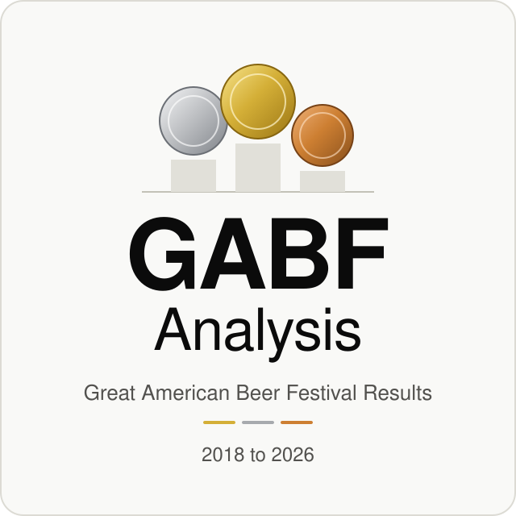

<p align="center"><picture><source media="(prefers-color-scheme: dark)" srcset="docs/assets/banner-dark.svg"><source media="(prefers-color-scheme: light)" srcset="docs/assets/banner-light.svg"></picture></p>

[](https://github.com/klappe-pm/GABF-Analysis/actions/workflows/deploy-pages.yml) [](https://github.com/klappe-pm/GABF-Analysis/deployments) [](https://klappe-pm.github.io/GABF-Analysis/) [](LICENSE) [](package.json) [](https://github.com/klappe-pm/GABF-Analysis/commits/main) [](data/results) [](data/enriched/breweries.json) [](#data-sources-and-honesty-notes) [](docs/2026/winner)

# GABF Analysis

An open, reproducible dataset and static dashboard site for the Great American Beer Festival awards. Official winners lists are parsed into one CSV row per medal, every brewery is enriched from Open Brewery DB and curated reference tables, and a plain Node build renders interactive Apache ECharts dashboards to GitHub Pages: who wins, in which styles, from which states and Federal Reserve districts, under which owners, and how that changes year to year. Every estimate is labeled, every gap is stated, and nothing is invented.

**Live site: [klappe-pm.github.io/GABF-Analysis](https://klappe-pm.github.io/GABF-Analysis/)**

<!--- Screenshots: add dashboard screenshots here (for example docs/assets/screenshot-overview.png) once they are captured. -->

## Highlights

- **1,907 medal rows** across 947 breweries and 177 categories, with 2021 to 2026 loaded from the official Brewers Association winners lists.
- **Five dashboards** (Overview, Geography, Categories, Breweries, Ownership and economics) under one filter row: year, medal, classic or special category, style family, category, region, state, brewery type, ownership, distribution, ABV band, and search. Filters live in the URL, so any view can be shared.
- **Geography with controls:** a US map, Census regions and divisions, Federal Reserve districts (county level for split states), medals per million residents and per $100 billion of real GDP, and demographic controls by state and district.
- **Brewery deep dives** with locations, ownership, distributors, a ten year medal trend that says plainly when a brewery did not exist yet, and estimated barrels, revenue, and margins marked (E).
- **336 researched 2026 beer profiles**, one per medal, with style, ABV, IBU, hops, malts, yeast, adjuncts, and source links, plus a SQLite database built from them with full text search.
- **A single file dashboard**, [gabf-dashboard.html](gabf-dashboard.html), that embeds ECharts, the map, every medal row, and the deep dives, so it opens by double click with no server and no network.
- **One command per new year:** when the Brewers Association posts the official list, `node scripts/new-year.mjs --year 2027` fetches, parses, enriches, tests, and rebuilds.
- **No runtime network dependency:** ECharts is vendored at build time; every chart has a table view and a save as PNG button.

## Quick start

Use Node 22 or newer, which is what CI runs: the test suite and the SQLite scripts (`build-winner-db.mjs`, `build-explorer.mjs`) use the built in `node:sqlite` module.

```bash
git clone https://github.com/klappe-pm/GABF-Analysis.git && cd GABF-Analysis && npm ci && npm run build && npm run serve
```

Then open http://localhost:8080/ for the overview dashboard and http://localhost:8080/dashboards/ for the others. To skip the server entirely, open the committed single file dashboard from the repository root:

```bash
cd GABF-Analysis && open gabf-dashboard.html
```

Before opening a pull request, run the full gate from the repository root:

```bash
cd GABF-Analysis && npm run verify
```

## How the data pipeline works

1. **Ingest.** `scripts/fetch-winners.mjs` downloads the official winners list PDF and `scripts/parse-winners.mjs` turns it into `data/results/gabf-YYYY.csv`, one row per medal with total entrants per category, plus Brewery of the Year awards. A hand made sheet can come in through `npm run import-csv`, and the awards ceremony captions can be drafted into rows with `scripts/import-ceremony-transcript.mjs` until the PDF is posted; drafts are replaced wholesale by the official list.
2. **Enrich.** `scripts/enrich-breweries.mjs` matches every brewery in Open Brewery DB by normalized name and city, applies `data/reference/brewery-overrides.csv`, and writes `data/enriched/breweries.json`. Curated reference tables add categories and style families, states and regions, ownership and investors, distributors, production, and the estimation parameters.
3. **Research profiles.** Each 2026 medal has a markdown profile under `docs/2026/winner/`. `node scripts/build-winner-db.mjs 2026` builds `data/enriched/winners-2026.sqlite` (beers, breweries, categories, ingredients, sources, full text search, and rate views), and `node scripts/build-explorer.mjs` fills the explorer prototype from that database into `gabf-explorer.html`.
4. **Fed districts and controls.** `scripts/build-fed-districts.mjs` assigns every medal to a Federal Reserve district from Census county files, and `scripts/fetch-state-indicators.mjs` adds Census population, BEA GDP, ACS demographics, urban share, PIAAC literacy, and NCHS life expectancy so medal counts can be read per capita and per unit of output.
5. **Validate.** `npm run validate` checks every medal row (known state and medal, no duplicates, consistent entry counts), compares each year with `data/results/year-summary.csv`, and compares matched breweries' Open Brewery DB states with the printed state.
6. **Publish.** `npm run build` renders `dist/` (dashboards, brewery and category pages, reports, JSON and CSV exports) and `npm run build:standalone` regenerates `gabf-dashboard.html`. The deploy-pages workflow runs the same gates on every pull request and publishes to GitHub Pages from main.

The ingest-results workflow runs every two hours from October 11 to October 20 and on demand, so a new year's list lands without a manual step. The full procedure is in [docs/runbook-new-year.md](docs/runbook-new-year.md) and the design is in [docs/architecture.md](docs/architecture.md).

## Commands

All commands run from the repository root.

| command | what it does |
|---|---|
| `npm run fetch -- --year 2026` | download the official winners list PDF to data/raw/ |
| `npm run parse -- --year 2026` | parse the PDF into data/results/gabf-2026.csv and report unparsed lines |
| `npm run import-csv -- --year 2026 --input file.csv` | normalize a hand made results sheet instead |
| `npm run enrich` | Open Brewery DB lookups into data/enriched/breweries.json |
| `npm run styles -- --input guidelines.pdf --year 2026` | refresh category ABV, IBU, and SRM ranges from the style guidelines |
| `npm run validate` | structural data checks; add `-- --live` to re-query Open Brewery DB |
| `npm run build` | render dist/ |
| `npm run build:standalone` | regenerate gabf-dashboard.html |
| `npm run serve` | preview dist/ at http://localhost:8080/ |
| `npm run verify` | prose check, tests, validation, site build, single file build |
| `node scripts/new-year.mjs --year 2027` | fetch, parse, enrich, test, and rebuild for a new year |
| `node scripts/build-winner-db.mjs 2026` | build the 2026 winners SQLite database (Node 22 or newer) |
| `node scripts/build-explorer.mjs` | build gabf-explorer.html from that database (Node 22 or newer) |
| `node scripts/scaffold-brewery.mjs --brewery "Name"` | start a brewery deep dive with a research checklist |

## Project structure

| path | contents |
|---|---|
| `data/results/` | one normalized CSV per year, plus year totals, Brewery of the Year, and World Beer Cup rows |
| `data/reference/` | categories and style families, states, Fed districts and county splits, state and district indicators, ownership, distributors, production, overrides, estimation parameters, US competition registry |
| `data/enriched/` | generated Open Brewery DB enrichment and the 2026 winners SQLite database |
| `data/raw/` | text extracted from the official winners list PDFs |
| `breweries/` | brewery deep dives in markdown; `template-brewery.md` is the scaffold |
| `docs/2026/winner/` | 336 researched beer profiles, one per 2026 medal |
| `docs/` | architecture, data sources, data dictionary, estimation method, research playbook, runbook |
| `scripts/` | the pipeline: fetch, parse, import, enrich, validate, build, and helpers in `scripts/lib/` |
| `site/` | stylesheet, ECharts option builders, dashboard client, US states GeoJSON, standalone and explorer templates |
| `tests/` | node test runner suites with fixtures |
| `gabf-dashboard.html` | generated single file dashboard, committed so it opens without a build |
| `.github/workflows/` | deploy-pages (gates and publish) and ingest-results (scheduled ingest) |

## Data sources and honesty notes

- **Official lists win.** 2021 to 2026 come from the Brewers Association's published winners lists; the 2026 PDF is kept at [docs/2026/GABF-2026-Winners-List.pdf](docs/2026/GABF-2026-Winners-List.pdf). The 2026 list awards 336 medals to 243 breweries and cideries from 7,267 entries.
- **Partial and pending years.** 2018 and 2019 hold only seed rows from secondary sources, marked "Partial seed" and shown as partial in the site; 2020 is pending. Streaks skip partial years instead of counting them as misses.
- **Known gap.** One 2022 medal (category 13 Honey Beer gold, Hachimitsu Mai by Deschutes Brewery) is absent because the official list prints no city for it.
- **Estimates are marked (E).** Barrels, revenue, and margins are estimates traceable to [data/reference/estimation-parameters.json](data/reference/estimation-parameters.json), [data/reference/production.csv](data/reference/production.csv), or a brewery profile. The method is in [docs/estimation-method.md](docs/estimation-method.md).
- **Ownership is flagged.** Ownership rows carry a `verified` flag that is set only after checking a primary source.
- **Enrichment coverage.** 472 of 947 breweries match an Open Brewery DB record; the rest (often cideries, closures, and renames) keep their printed city and state.
- **Profiles say what was not found.** In the 2026 beer profiles, `null` means the value was looked for and not published, never zero, and each profile's research notes say what was tried.

Sources in full: [docs/data-sources.md](docs/data-sources.md). Column definitions: [docs/data-dictionary.md](docs/data-dictionary.md).

## Contributing

Corrections and improvements are welcome. Start with [CONTRIBUTING.md](CONTRIBUTING.md); a data correction has its own [issue form](https://github.com/klappe-pm/GABF-Analysis/issues/new/choose) that asks for the year, category, medal, brewery, and a source link. Please follow the [Code of Conduct](CODE_OF_CONDUCT.md), and report security issues as described in [SECURITY.md](SECURITY.md). Release notes are in [CHANGELOG.md](CHANGELOG.md).

## Citation

If you use this dataset or site in research or writing, please cite it. GitHub shows a "Cite this repository" button generated from [CITATION.cff](CITATION.cff):

```text
Lappe, K. (2026). GABF Analysis (Version 0.1.0) [Computer software]. https://github.com/klappe-pm/GABF-Analysis
```

## License

The code is released under the [MIT License](LICENSE). Competition results are the Brewers Association's published outcomes; style guideline ranges are used with attribution for non commercial analysis; brewery location data comes from Open Brewery DB; Apache ECharts is Apache 2.0; us-atlas boundaries derive from US Census Bureau data.
